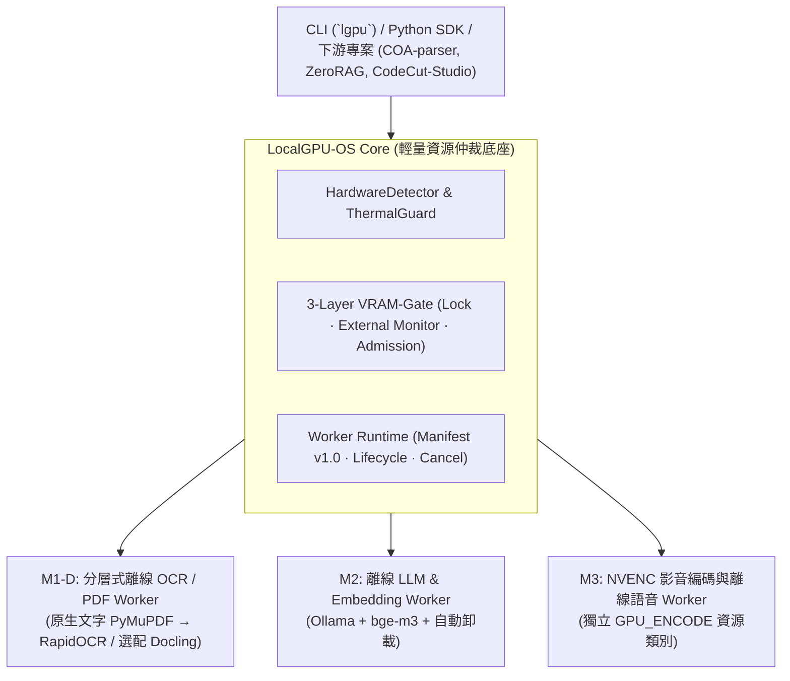

# ⚡ LocalGPU-OS

> **與 AI 模型及應用程式無關的本機運算資源仲裁層**  
> 負責管理 GPU 資源、工作負載、隔離執行環境與硬體安全，讓多個 AI 應用程式安全共享同一張本機顯卡——**零雲端 API 使用費、無強制訂閱費、預設本機運算**。

🌐 **語言 / Languages**: **繁體中文** | [English](README_EN.md)

---

## 🎯 核心定位

`LocalGPU-OS` 不是另一個把所有 AI 工具塞在一起的龐大平台，而是專為個人工作站與筆電獨顯（如 8GB RTX 4060 Laptop，亦相容 6GB～24GB+ 各級 NVIDIA 顯卡與 CPU 降級）打造的**底層本機運算資源仲裁層**。

它只專注做好四件事：
1. **知道本機有什麼硬體**（硬體能力探測 `HardwareProfile`）。
2. **知道目前還有多少可用資源**（同時感知受控 Worker 與外部非受控程序的 VRAM 佔用）。
3. **安全地安排工作**（三層 `VRAM-Gate` 仲裁、動態策略分級、溫控節流與 Fail-Safe 失效安全）。
4. **可靠地啟動、監控與回收 Worker**（獨立隔離 `.venv`、標準化契約、優雅取消與異常恢復）。

---

## ✨ 核心架構特色

- **🔒 三層 `VRAM-Gate` 資源仲裁**：結合「Registry Lock 原子讀寫租約（TTL / Heartbeat / 防 PID 重用 / Fencing Token）」＋「外部 GPU 即時觀測」＋「不重複扣除之動態入場審查 (`VRAM_admission = VRAM_free,observed - VRAM_safety - VRAM_pending`)」，並支援抽象化 `EvictionProvider` 卸載與事後複驗。
- **🎛️ 靜態硬體、動態快照與策略分離**：`HardwareProfile` 記錄物理能力，`HardwareSnapshot` 記錄具新鮮度時效之即時狀態，`ExecutionPolicyTier` 與 `AdmissionControl` 動態決策。
- **🌡️ 四態溫控節流守衛 (`ThermalGuard`)**：以 `NORMAL` / `COOLING` / `CRITICAL` / `SENSOR_DEGRADED` 四態狀態機搭配遲滯時間調節合作式 Worker 節奏（不取代 NVIDIA 驅動與 BIOS 原生保護）。
- **🛡️ 失效安全資源管理 (`Fail-Safe`)**：GPU 探測失敗、VRAM 讀值異常、租約損壞或卸載失敗時，對 GPU 任務採 **Fail-Closed** 拒絕，絕不在資訊不足時冒險放行；純 CPU 任務可獨立安全運行。
- **🧩 零重型依賴 Core OS ＋ 隔離 Workers**：核心底座不含 PyTorch / Paddle / TensorFlow；每個 Worker 各自獨立 `.venv` 並遵循 `Worker Manifest Contract v1.0`，支援五類資源解耦（含獨立 `GPU_ENCODE` NVENC）。

---

## 🏗️ 系統架構與分期路線

- **M0（當前）**：規格定案與治理基線（[PRD.md](PRD.md) `v1.1.0`、[GLOSSARY.md](GLOSSARY.md)、[THIRD_PARTY_NOTICES.md](THIRD_PARTY_NOTICES.md)）。
- **M1-A**：Hardware Foundation（硬體探測、`HardwareProfile`、動態策略、`lgpu doctor`）。
- **M1-B**：Resource Arbitration（三層 `VRAM-Gate`、租約恢復、溫控三態、`lgpu status`）。
- **M1-C**：Worker Runtime（`Worker Manifest v1.0`、生命週期管理、優雅取消、`lgpu run` ＋ Python SDK）。
- **M1-D**：第一個實戰應用 — 分層式離線 OCR / PDF Worker（預設 `PyMuPDF` + `RapidOCR`，選配 `Docling`）。
- **M2 ~ M4**：離線 LLM & Embedding Worker、本機安全 HTTP API（M2）、NVENC 影音與語音 Worker（M3）、MCP Server 與多語系文件發布（M4）。

---

## 📄 專案文件

- [產品需求規格書 (PRD.md — v1.1.2 Frozen)](PRD.md)
- [M1-A 工程設計與測試規格 (docs/M1-A_DESIGN_AND_TEST_SPEC.md)](docs/M1-A_DESIGN_AND_TEST_SPEC.md)
- [專案術語字典 (GLOSSARY.md)](GLOSSARY.md)
- [第三方套件與模型授權清單 (THIRD_PARTY_NOTICES.md)](THIRD_PARTY_NOTICES.md)

---

## ⚖️ 授權協議 (License)

本專案原始碼採用 [Apache License 2.0](LICENSE) 開源授權（第三方套件與模型權重請參閱 [THIRD_PARTY_NOTICES.md](THIRD_PARTY_NOTICES.md)）。  
Copyright © 2026 **etrnya**.
