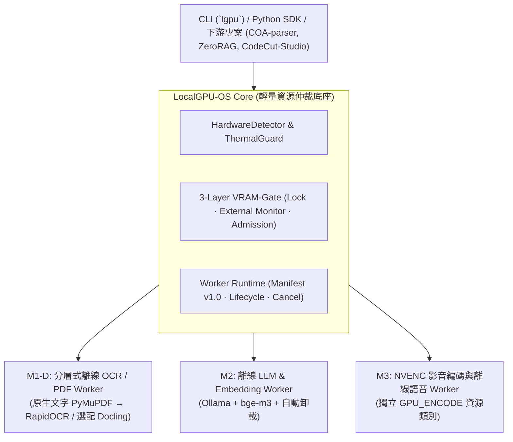

# ⚡ LocalGPU-OS

> **與 AI 模型及應用程式無關的本機運算資源仲裁層**  
> 負責管理 GPU 資源、工作負載、隔離執行環境與硬體安全，讓多個 AI 應用程式安全共享同一張本機顯卡——**零雲端 API 使用費、無強制訂閱費、預設本機運算**。

🌐 **語言 / Languages**: **繁體中文** | [English](README_EN.md)

[](LICENSE)
[](https://www.python.org/)
[](PRD.md)

---

## 🎯 核心定位

`LocalGPU-OS` 不是另一個把所有 AI 工具塞在一起的龐大平台，而是專為個人工作站與筆電獨顯（如 8GB RTX 4060 Laptop，亦相容 6GB～24GB+ 各級 NVIDIA 顯卡與 CPU 降級）打造的**底層本機運算資源仲裁層**。

它只專注做好四件事：
1. **知道本機有什麼硬體**（硬體能力探測 `HardwareProfile`）。
2. **知道目前還有多少可用資源**（同時感知受控 Worker 與外部非受控程序的 VRAM 佔用）。
3. **安全地安排工作**（三層 `VRAM-Gate` 仲裁、動態策略分級、溫控節流與 Fail-Safe 失效安全）。
4. **可靠地啟動、監控與回收 Worker**（獨立隔離 `.venv`、標準化契約、優雅取消與異常恢復）。

---

## ✨ 核心架構特色

- **🔒 三層 `VRAM-Gate` 資源仲裁**：結合「Registry Lock 原子讀寫租約（TTL / Heartbeat / 防 PID 重用 / Fencing Token）」＋「外部 GPU 即時觀測」＋「不重複扣除之動態入場審查 (`VRAM_admission = VRAM_free,observed - VRAM_safety - VRAM_pending`)」，並支援抽象化 `EvictionProvider` 卸載與事後複驗。
- **🎛️ 靜態硬體、動態快照與策略分離**：`HardwareProfile` 記錄物理能力，`HardwareSnapshot` 記錄具新鮮度時效之即時狀態，`ExecutionPolicyTier` 與 `AdmissionControl` 動態決策。
- **🌡️ 四態溫控節流守衛 (`ThermalGuard`)**：以 `NORMAL` / `COOLING` / `CRITICAL` / `SENSOR_DEGRADED` 四態狀態機搭配遲滯時間調節合作式 Worker 節奏（不取代 NVIDIA 驅動與 BIOS 原生保護）。
- **🛡️ 失效安全資源管理 (`Fail-Safe`)**：GPU 探測失敗、VRAM 讀值異常、租約損壞或卸載失敗時，對 GPU 任務採 **Fail-Closed** 拒絕，絕不在資訊不足時冒險放行；純 CPU 任務可獨立安全運行。
- **🧩 零重型依賴 Core OS ＋ 隔離 Workers**：核心底座不含 PyTorch / Paddle / TensorFlow；每個 Worker 各自獨立 `.venv` 並遵循 `Worker Manifest Contract v1.0`，支援五類資源解耦（含獨立 `GPU_ENCODE` NVENC）。

---

## 🏗️ 系統架構與分期路線



- **M0（已凍結 — `m0-prd-v1.1.2-frozen`）**：規格定案與治理基線（[PRD.md](PRD.md) `v1.1.2`、[GLOSSARY.md](GLOSSARY.md)、[THIRD_PARTY_NOTICES.md](THIRD_PARTY_NOTICES.md)）。
- **M1-A（✅ 已完成並實機驗收 — `m1-a-hardware-foundation-v1.0.0`）**：Hardware Foundation（`HardwareProfile` / `HardwareSnapshot`、`PolicyEngine`、`lgpu doctor`，12 tests）。
- **M1-B（✅ 已完成並實機驗收 — `m1-b-resource-arbitration-v1.0.0`）**：Resource Arbitration（`RegistryLock`、原子 `FileLeaseStore`、`VRAM_pending` 觀測確認、Fencing Token、`LEASE_RECLAIM_BLOCKED`、全有或全無 `VramGate`、四態 `ThermalGuard`、`OllamaEvictionProvider`、`lgpu status`，13 tests）。
- **M1-C（✅ 已完成並實機驗收 — `m1-c-worker-runtime-v1.0.0`）**：Worker Runtime（`WorkerRegistry`、`Worker Manifest Contract v1.0`、嚴格 `.venv` 解析、`json_file_manifest` 防 Base64／Path Traversal／Symlink 逃逸、`DISK_SPACE_INSUFFICIENT`、7 步驟跨平台取消與 Step 7 Fail-Closed VRAM 重採樣、`lgpu run` ＋ Python SDK，15 tests）。
- **M1-D（✅ 已完成並實機驗收 — `m1-d-ocr-pdf-v1.0.0`）**：第一個實戰隔離 Worker — [workers/ocr_pdf](workers/ocr_pdf/README.md)（D1 PyMuPDF 原生文字 PDF → D2 RapidOCR 離線 CUDA / CPU 推論與載入前 SHA-256 驗證 → D3 VRAM/OOM、溫控、多頁取消、強制終止保留先前有效輸出與混合批次壓力測試 → D4 全流程整合與 5 輪穩定性驗收，16 tests；全倉累計 **56 / 56** 測試通過，已於 Windows 11 + RTX 4060 Laptop 實機驗收）。
- **M2 ~ M4（後續規劃）**：離線 LLM & Embedding Worker、本機安全 HTTP API（M2）、NVENC 影音與語音 Worker（M3）、MCP Server 與多語系文件發布（M4）。

---

## 🚀 快速開始 (Quick Start — M1 Complete)

> **目前正式驗證平台**：Windows 11 + NVIDIA CUDA（單卡，實機於 RTX 4060 Laptop 8GB 驗證）；Linux 為次驗證平台；無 NVIDIA 顯卡或 VRAM 不足時可安全降級至 `CPU_INT8`。核心底座無重型第三方依賴（Python 3.10+ 即可執行）。

```powershell
# 1. 取得程式碼
git clone https://github.com/etrnya/LocalGPU-OS.git
cd LocalGPU-OS

# 2. 硬體健檢與動態策略判定（M1-A）
$env:PYTHONPATH="src"; python -m localgpu_os.presentation.cli doctor --json

# 3. 檢視即時 VRAM-Gate 資源仲裁與活躍租約狀態（M1-B）
$env:PYTHONPATH="src"; python -m localgpu_os.presentation.cli status --json

# 4. 執行隔離離線 OCR / PDF Worker（M1-C + M1-D；安裝步驟見 workers/ocr_pdf/README.md）
$env:PYTHONPATH="src"; python -m localgpu_os.presentation.cli run ocr_pdf `
  --input-manifest .\inputs\manifest.json `
  --allowed-root .\inputs `
  --allow-cpu-fallback `
  --json `
  -- --output-dir .\output --job-id job_001

# 5. 執行全倉測試（M1-A ~ M1-D，共 56 項）
$env:PYTHONPATH="src"; python -m unittest discover -s tests -v
```

---

## 📄 專案文件

- [產品需求規格書 (PRD.md — v1.1.2 Frozen)](PRD.md)
- [M1-A 工程設計與測試規格 (docs/M1-A_DESIGN_AND_TEST_SPEC.md)](docs/M1-A_DESIGN_AND_TEST_SPEC.md)
- [專案術語字典 (GLOSSARY.md)](GLOSSARY.md)
- [第三方套件與模型授權清單 (THIRD_PARTY_NOTICES.md)](THIRD_PARTY_NOTICES.md)

---

## ⚖️ 授權協議 (License)

本專案原始碼採用 [Apache License 2.0](LICENSE) 開源授權（第三方套件與模型權重請參閱 [THIRD_PARTY_NOTICES.md](THIRD_PARTY_NOTICES.md)）。  
Copyright © 2026 **etrnya**.
