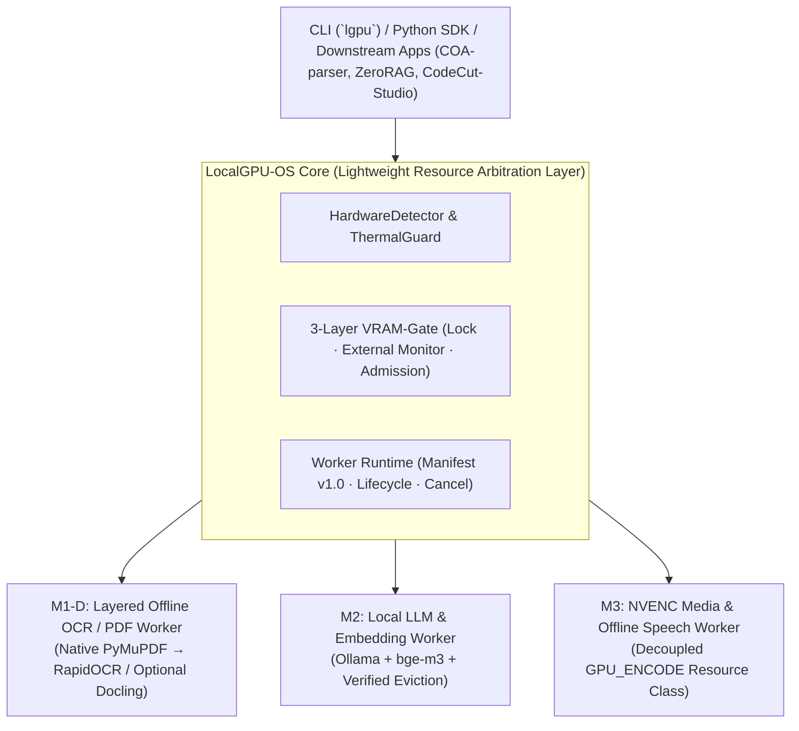

# ⚡ LocalGPU-OS

> **A Model- and Application-Agnostic Local Compute Resource Arbitration Layer**  
> Manages GPU resources, workloads, isolated worker environments, and hardware safety so multiple AI applications can reliably share a single local GPU — **zero cloud API fees, no mandatory subscriptions, local-first by default**.

🌐 **Languages**: [繁體中文](README.md) | **English**

---

## 🎯 Core Positioning

`LocalGPU-OS` is **not** a monolithic AI mega-suite. It is a lightweight **local compute resource arbitration layer** built for personal workstations and discrete laptop GPUs (from 6GB/8GB RTX 4060 Laptops to 24GB+ cards, with safe CPU fallback).

It focuses strictly on four responsibilities:
1. **Know what hardware exists** (`HardwareProfile` probing).
2. **Know how much resource is actually free** (tracking both managed workers and external unmanaged GPU processes).
3. **Schedule workloads safely** (3-layer `VRAM-Gate`, dynamic execution tiers, thermal pacing, and Fail-Safe admission).
4. **Launch, monitor, and reclaim isolated workers reliably** (per-worker `.venv`, standardized manifest contract, graceful cancellation, and crash recovery).

---

## ✨ Key Architectural Highlights

- **🔒 Three-Layer `VRAM-Gate`**: Combines a *Registry-Locked Atomic Lease* (TTL, heartbeat, PID-reuse guard, fencing token) + *External GPU Monitoring* + *Dynamic Admission Control* (`VRAM_admission = VRAM_free,observed - VRAM_safety - VRAM_pending`, avoiding double-subtraction) with pluggable `EvictionProvider` verification.
- **🎛️ Hardware Profile, Live Snapshot & Runtime Policy Decoupled**: `HardwareProfile` captures static capabilities, `HardwareSnapshot` enforces freshness TTLs, and `AdmissionControl` gates execution dynamically.
- **🌡️ Four-State Thermal Pacing (`ThermalGuard`)**: `NORMAL` / `COOLING` / `CRITICAL` / `SENSOR_DEGRADED` state machine with hysteresis to pace cooperative workers (complements—never replaces—native NVIDIA driver and BIOS protections).
- **🛡️ Fail-Safe Resource Management**: Fails closed on GPU tasks whenever hardware probing, VRAM reads, lease state, or eviction verification fails, while allowing pure `CPU_COMPUTE` workloads to degrade safely.
- **🧩 Zero-Heavy-Dependency Core + Isolated Workers**: Core OS never installs PyTorch, PaddlePaddle, or TensorFlow. Workers run in isolated `.venv` environments via `Worker Manifest Contract v1.0` with decoupled resource classes (including dedicated `GPU_ENCODE` for NVENC).

---

## 🏗️ Architecture & Phased Roadmap

- **M0 (Current)**: Specification & governance baseline ([PRD.md](PRD.md) `v1.1.0`, [GLOSSARY.md](GLOSSARY.md), [THIRD_PARTY_NOTICES.md](THIRD_PARTY_NOTICES.md)).
- **M1-A**: Hardware Foundation (`HardwareProfile`, dynamic policy engine, `lgpu doctor`).
- **M1-B**: Resource Arbitration (3-layer `VRAM-Gate`, zombie recovery, `ThermalGuard`, `lgpu status`).
- **M1-C**: Worker Runtime (`Worker Manifest v1.0`, lifecycle & graceful cancellation, `lgpu run` + Python SDK).
- **M1-D**: First production worker — Layered Offline OCR / PDF Worker (`PyMuPDF` + `RapidOCR` default, `Docling` optional).
- **M2 – M4**: Local LLM & Embedding Worker + secured localhost HTTP API (M2), NVENC Media & Speech Worker (M3), MCP Server & multi-language documentation (M4).

---

## 📄 Documentation

- [Product Requirements Document (PRD.md — v1.1.2 Frozen)](PRD.md) *(Traditional Chinese)*
- [M1-A Engineering Design & Test Spec (docs/M1-A_DESIGN_AND_TEST_SPEC.md)](docs/M1-A_DESIGN_AND_TEST_SPEC.md)
- [Domain Glossary (GLOSSARY.md)](GLOSSARY.md)
- [Third-Party Notices (THIRD_PARTY_NOTICES.md)](THIRD_PARTY_NOTICES.md)

---

## ⚖️ License

Source code is licensed under the [Apache License 2.0](LICENSE). Third-party packages, binaries, and model weights remain subject to their respective licenses (see [THIRD_PARTY_NOTICES.md](THIRD_PARTY_NOTICES.md)).  
Copyright © 2026 **etrnya**.
